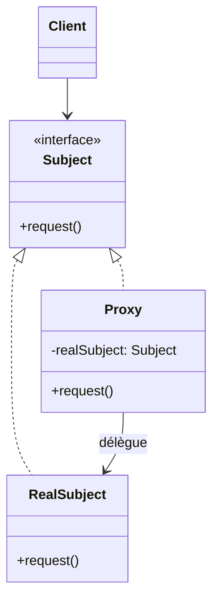
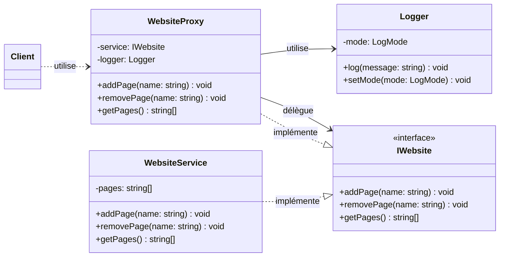
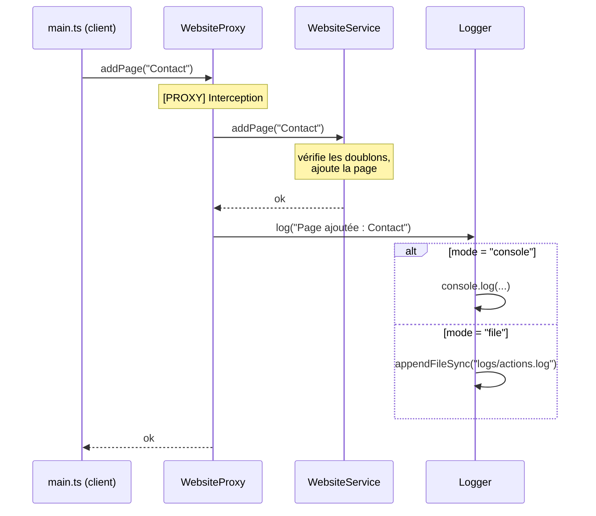
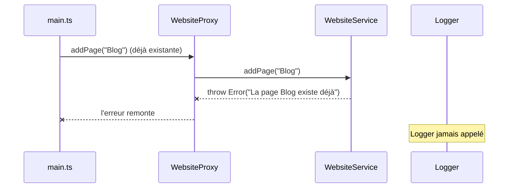
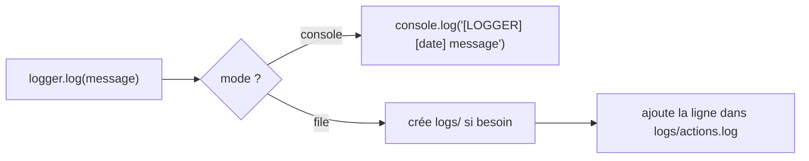

# proxy-logger

> Exercice en TypeScript sur le **design pattern Proxy**, appliqué à un **logger**.
> Chaque ajout ou suppression de page sur un site web est enregistré, **dans la console** ou **dans un fichier**, selon la configuration choisie par l'utilisateur.

## Sommaire

1. [L'énoncé](#1-lénoncé)
2. [C'est quoi le pattern Proxy ?](#2-cest-quoi-le-pattern-proxy-)
3. [Architecture du projet](#3-architecture-du-projet)
4. [Le code, fichier par fichier](#4-le-code-fichier-par-fichier)
5. [Déroulement d'un appel](#5-déroulement-dun-appel)
6. [Lancer la démo](#6-lancer-la-démo)
7. [Pourquoi un Proxy ici ?](#7-pourquoi-un-proxy-ici-)
8. [Récap](#8-récap)

---

## 1. L'énoncé

> L'ajout ou la suppression de page dans le site web est loggué, soit dans la console, soit dans un fichier, en fonction des paramètres de l'utilisateur.

Contraintes :
- TypeScript ;
- utiliser le pattern **Proxy** ;
- le mode de log (console ou fichier) est un **paramètre**.

---

## 2. C'est quoi le pattern Proxy ?

Le **Proxy** est un design pattern **structurel** (famille du *Gang of Four*).
Son principe : on place un objet **intermédiaire** devant le vrai objet. Cet intermédiaire **a la même interface** que le vrai objet, donc le client ne voit pas la différence. Il **intercepte** chaque appel, peut faire quelque chose **avant et/ou après**, puis **transmet** l'appel au vrai objet.

### Analogie : la secrétaire d'un directeur

```
   Visiteur  ──►  Secrétaire  ──►  Directeur
   (client)       (Proxy)          (vrai objet)
                     │
                     └──► note chaque visite dans le registre (log)
```

- Le visiteur veut voir le directeur. Il passe par la secrétaire, mais pour lui c'est transparent : il obtient son rendez-vous.
- La secrétaire **ne fait pas le travail du directeur** : elle lui transmet la demande.
- En plus, elle **note chaque visite** dans un registre.
- Le directeur, lui, ne sait même pas que le registre existe : il fait juste son métier.

Dans ce projet :

| Analogie      | Code               |
|---------------|--------------------|
| Visiteur      | `main.ts` (client) |
| Secrétaire    | `WebsiteProxy`     |
| Directeur     | `WebsiteService`   |
| Registre      | `Logger`           |

### Structure générale du pattern



Les trois éléments clés :
1. **Subject** : l'interface commune ;
2. **RealSubject** : l'objet qui fait le vrai travail ;
3. **Proxy** : implémente la même interface, garde une référence vers le RealSubject et lui délègue les appels.

### Les variantes de Proxy

| Type de proxy          | Rôle                                                       |
|------------------------|------------------------------------------------------------|
| **Proxy de journalisation** | Enregistre les appels (**c'est le cas ici**)          |
| Proxy de protection    | Vérifie les droits avant d'autoriser l'appel               |
| Proxy virtuel          | Crée l'objet coûteux seulement au moment où on en a besoin |
| Proxy de cache         | Garde le résultat en mémoire pour ne pas le recalculer     |
| Proxy distant          | Représente localement un objet situé sur un autre serveur  |

---

## 3. Architecture du projet

```
proxy-logger/
├── src/
│   ├── IWebsite.ts        → l'interface commune       (Subject)
│   ├── WebsiteService.ts  → le vrai service           (RealSubject)
│   ├── WebsiteProxy.ts    → le proxy qui intercepte   (Proxy)
│   ├── Logger.ts          → écrit les logs (console ou fichier)
│   └── main.ts            → le client / la démo
├── logs/
│   └── actions.log        → fichier créé en mode "file"
├── diagramme.md           → diagramme de classes
├── package.json
└── tsconfig.json
```

### Diagramme de classes



Le `Client` (`main.ts`) dépend uniquement de `WebsiteProxy` : il n'a aucun lien direct avec `WebsiteService` et passe toujours par le proxy.

---

## 4. Le code, fichier par fichier

### `IWebsite.ts` : l'interface commune

```ts
export interface IWebsite {
  addPage(name: string): void;
  removePage(name: string): void;
  getPages(): string[];
}
```

C'est le **contrat** que le vrai service **et** le proxy respectent tous les deux.
C'est grâce à elle que le client peut utiliser l'un ou l'autre **sans changer son code**.

### `WebsiteService.ts` : le vrai service

```ts
export class WebsiteService implements IWebsite {
  private pages: string[] = [];

  addPage(name: string): void {
    if (this.pages.includes(name)) {
      throw new Error(`La page ${name} existe déjà`);
    }
    this.pages.push(name);
    console.log(`[SERVICE] Page ${name} ajoutée`);
  }
  // removePage(), getPages() ...
}
```

Il contient la **logique métier** : gérer la liste des pages et refuser les doublons ou les suppressions impossibles.
👉 Il ne contient **aucune ligne de log** : il ne sait pas que le logger existe.

### `Logger.ts` : le logger configurable

```ts
export type LogMode = "console" | "file";

export class Logger {
  constructor(private mode: LogMode) {}

  log(message: string): void {
    const date = new Date().toLocaleString("fr-FR");
    const entry = `[${date}] ${message}`;

    if (this.mode === "console") {
      console.log(`[LOGGER] ${entry}`);
    } else {
      mkdirSync("logs", { recursive: true });
      appendFileSync("logs/actions.log", entry + "\n");
    }
  }

  setMode(mode: LogMode): void {
    this.mode = mode;
  }
}
```

- `LogMode` est un **type union** : TypeScript n'accepte que `"console"` ou `"file"`, une faute de frappe est détectée à la compilation.
- Le mode est choisi **à la création** (`new Logger("console")`) et peut être **changé en cours de route** (`setMode("file")`). C'est le **paramètre utilisateur** demandé par l'énoncé.
- En mode `file`, le dossier `logs/` est créé s'il n'existe pas, et chaque entrée est **ajoutée à la fin** du fichier (`appendFileSync`).

### `WebsiteProxy.ts` : le Proxy

```ts
export class WebsiteProxy implements IWebsite {
  constructor(
    private service: IWebsite,
    private logger: Logger
  ) {}

  addPage(name: string): void {
    console.log("[PROXY] Interception de addPage()");
    this.service.addPage(name);                 // 1. délégation au vrai service
    this.logger.log(`Page ajoutée : ${name}`);  // 2. action en plus : le log
  }

  removePage(name: string): void {
    console.log("[PROXY] Interception de removePage()");
    this.service.removePage(name);
    this.logger.log(`Page supprimée : ${name}`);
  }

  getPages(): string[] {
    return this.service.getPages();             // lecture : pas de log
  }
}
```

C'est le **cœur de l'exercice** :
- il **implémente `IWebsite`**, donc il se fait passer pour le vrai service ;
- il reçoit le vrai service et le logger **par le constructeur** (injection de dépendances) ;
- pour `addPage` / `removePage`, il **délègue** puis **logue** ;
- pour `getPages`, il délègue simplement : une lecture ne modifie pas le site, donc on ne la logue pas.

> 💡 **Détail important** : le log est fait **après** l'appel au service.
> Si le service lève une erreur (page déjà existante, page introuvable), l'exécution s'arrête avant le log.
> On ne logue donc **que les actions qui ont vraiment réussi**.

### `main.ts` : le client

```ts
const service = new WebsiteService();
const logger  = new Logger("console");            // paramètre utilisateur
const proxy   = new WebsiteProxy(service, logger);

service.addPage("Accueil");      // TEST 1 : sans proxy  → pas de log
proxy.addPage("Contact");        // TEST 2 : avec proxy  → log console
proxy.addPage("Blog");

logger.setMode("file");          // TEST 3 : on change le paramètre
proxy.removePage("Contact");     //          → log dans logs/actions.log

console.log(proxy.getPages());   // [ 'Accueil', 'Blog' ]
```

---

## 5. Déroulement d'un appel

### `proxy.addPage("Contact")` en mode console



### Le cas d'erreur : rien n'est loggué



### Le choix du mode de log



---

## 6. Lancer la démo

```bash
npm install
npx tsx src/main.ts
```

Sortie attendue :

```
=== TEST 1 : SANS PROXY ===
[SERVICE] Page Accueil ajoutée

=== TEST 2 : AVEC PROXY ===
[PROXY] Interception de addPage()
[SERVICE] Page Contact ajoutée
[LOGGER] [14/10/2026 20:26:50] Page ajoutée : Contact
[PROXY] Interception de addPage()
[SERVICE] Page Blog ajoutée
[LOGGER] [14/10/2026 20:26:50] Page ajoutée : Blog

=== TEST 3 : MODE FICHIER ===
[PROXY] Interception de removePage()
[SERVICE] Page Contact supprimée

=== PAGES EXISTANTES ===
[ 'Accueil', 'Blog' ]
```

Et dans `logs/actions.log` :

```
[14/10/2026 20:26:50] Page supprimée : Contact
```

### Ce que montre chaque test

| Test | Appel                          | Ce qu'on observe                                                   |
|------|--------------------------------|--------------------------------------------------------------------|
| 1    | `service.addPage("Accueil")`   | Appel **direct** au service : la page est ajoutée mais **aucun log** |
| 2    | `proxy.addPage(...)`           | Le proxy intercepte, le service agit, le logger écrit **en console** |
| 3    | `setMode("file")` puis `proxy.removePage(...)` | Même proxy, mais le log part **dans le fichier** : pas de ligne `[LOGGER]` en console |

---

## 7. Pourquoi un Proxy ici ?

On aurait pu écrire `console.log` directement dans `WebsiteService`. Le Proxy est meilleur parce que :

| Principe | Comment le projet le respecte |
|---|---|
| **Responsabilité unique** (S de SOLID) | `WebsiteService` gère les pages, `Logger` écrit les logs, `WebsiteProxy` fait le lien. Chacun a **un seul** rôle. |
| **Ouvert/fermé** (O de SOLID) | On a ajouté le logging **sans modifier** `WebsiteService`. |
| **Transparence** | Le proxy implémente `IWebsite` : le client l'utilise exactement comme le vrai service. |
| **Configurable** | Le mode (`console` / `file`) se change sans toucher au proxy ni au service. |
| **Activable / désactivable** | Pour ne plus loguer, il suffit d'utiliser `service` au lieu de `proxy` (c'est ce que montre le TEST 1). |

### Limite à connaître

Le proxy n'est utile que si le client **passe par lui**. Dans `main.ts`, le TEST 1 appelle le service directement et contourne donc le log. Dans une vraie application, on ne donnerait au client **que** le proxy (typé `IWebsite`), et jamais le service brut.

---

## 8. Récap

```
                              ┌─────────────────────────────┐
                              │      IWebsite (interface)   │
                              └──────────────┬──────────────┘
                                 implémente  │  implémente
                               ┌─────────────┴─────────────┐
                               ▼                           ▼
┌──────────┐ utilise  ┌─────────────────┐  délègue  ┌─────────────────┐
│  Client  │ ───────► │  WebsiteProxy   │ ────────► │ WebsiteService  │
│ (main.ts)│          │  (intercepte)   │           │ (gère les pages)│
└──────────┘          └────────┬────────┘           └─────────────────┘
                               │ utilise
                               ▼
                      ┌─────────────────┐
                      │     Logger      │──► console   (mode "console")
                      │                 │──► fichier   (mode "file")
                      └─────────────────┘
```

- **Proxy** = un intermédiaire avec **la même interface** que le vrai objet.
- Il **intercepte** les appels, **délègue** le travail, et **ajoute** un comportement (ici le log).
- Le **vrai service ne change pas** : le logging est ajouté de l'extérieur.
- Le **Logger** choisit la destination (console ou fichier) selon le **paramètre utilisateur**.
- On ne logue que les **ajouts et suppressions réussis**.
